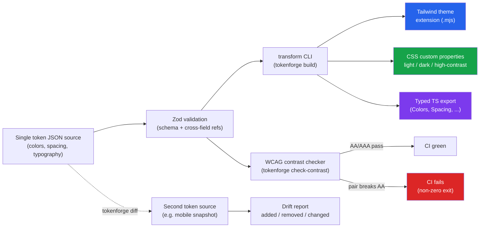

# tokenforge

**One design-token source of truth, forged into Tailwind, CSS, and TypeScript -- with a WCAG contrast gate that fails your CI before a bad pair ships.**


## The problem

Design and engineering teams end up maintaining color, spacing, and typography values in 3-5 disconnected places: a Figma library, a global CSS file, a `tailwind.config.js`, a mobile design-token JSON, maybe a native iOS/Android constants file. Every one of those copies drifts a little more each sprint. A rebrand or a dark-mode rollout then takes weeks, not because the work is hard, but because someone has to manually hunt down every surface that has its own stale copy of `primary-blue` -- and it's never the surface they remember to check.

tokenforge treats the token *source* as the only thing a human edits. Everything else -- Tailwind's theme, runtime CSS variables for light/dark/high-contrast, and a typed TS module for component libraries -- is generated. A drift between two sources, or a contrast pair that quietly stopped meeting WCAG AA after someone "just nudged the hex a little," is caught by a CLI command instead of a support ticket three months later.

## How it works



A single `tokens.json` is validated by a [Zod](https://zod.dev) schema (including cross-field checks -- e.g. a `contrastPairs` entry can't reference a color that doesn't exist). Three transforms then run against the same parsed document and emit, in parallel:

1. A **Tailwind theme extension** where every color resolves to `var(--tf-color-*)`, so switching a `data-theme`/`data-contrast` attribute at runtime re-themes Tailwind utility classes with zero rebuild.
2. **CSS custom properties** scoped to `:root`/`[data-theme='light']`, `@media (prefers-color-scheme: dark)` + `[data-theme='dark']`, and `[data-contrast='high']`.
3. A **typed TypeScript module** (`as const` objects, derived union types, a `resolveColor(token, mode)` helper) for component libraries that want compile-time-checked token names.

A **WCAG contrast checker** computes real contrast ratios (WCAG 2.x relative-luminance formula, not an approximation) for every declared foreground/background pair, across every mode that pair applies to, and exits non-zero the moment one breaks its required level -- usable directly as a CI gate on pull requests.

A **diff command** compares two token documents (e.g. the source of truth vs. a snapshot exported from the mobile app) and reports every added, removed, or changed value -- the exact kind of check that would have caught a stale pre-rebrand blue sitting in one surface for months.

## Quick start

```bash
npm install
npm run build      # compiles TypeScript -> dist/
npm test           # runs the Vitest suite (100+ tests)

# Validate + transform the bundled example token set
npm run cli -- build --input examples/tokens.json --out-dir examples/output

# Run the WCAG AA gate against the same source (exits 1 on any failing pair)
npm run cli -- check-contrast --input examples/tokens.json

# Detect drift between the source and a (deliberately stale) mobile snapshot
npm run cli -- diff --a examples/tokens.json --b examples/tokens-mobile-drifted.json
```

Or, once built, run the packaged bin directly:

```bash
node bin/tokenforge.mjs check-contrast --input examples/tokens.json
```

### Docker

```bash
docker build -t tokenforge .
docker run --rm tokenforge help
```

The image's build stage runs `npm run build && npm test`, so a Docker build fails the same way CI does if the transforms or contrast logic regress.

## CLI reference

```
tokenforge build --input <tokens.json> --out-dir <dir>
tokenforge check-contrast --input <tokens.json>
tokenforge diff --a <tokens-a.json> --b <tokens-b.json> [--fail-on-drift true]
```

| Command | What it does | CI use |
|---|---|---|
| `build` | Validates the source, writes `tailwind.theme.mjs`, `variables.css`, `tokens.ts` | Run on every commit; commit outputs or publish as build artifacts |
| `check-contrast` | Computes WCAG contrast ratios for every declared pair, across modes | **Non-zero exit on any AA/AAA failure** -- wire directly into a required PR check |
| `diff` | Reports added/removed/changed values between two token documents | Compare source vs. a per-surface snapshot to catch silent drift; `--fail-on-drift` makes it a gate too |

## Token schema (excerpt)

```json
{
  "name": "acme-design-system",
  "version": "1.0.0",
  "colors": {
    "primary": { "light": "#2563eb", "dark": "#60a5fa", "highContrast": "#1d4ed8" }
  },
  "spacing": { "md": "16px" },
  "typography": {
    "fontFamilies": { "sans": "Inter, system-ui, sans-serif" },
    "fontSizes": { "base": "16px" },
    "fontWeights": { "regular": 400 },
    "lineHeights": { "normal": 1.5 }
  },
  "contrastPairs": [
    { "name": "primary-button", "foreground": "primaryForeground", "background": "primary", "level": "AA" }
  ]
}
```

`dark` and `highContrast` are optional per color -- if omitted, every transform falls back to `light`, so nothing downstream ever receives an undefined value.

## Project layout

```
src/
  schema.ts              Zod schema + parseDesignTokens()
  contrast.ts             WCAG relative-luminance / contrast-ratio math + AA/AAA gate
  diff.ts                 Token drift detector
  cli.ts                  Argument parsing + the three subcommands
  transforms/
    tailwind.ts            -> Tailwind theme.extend fragment
    css.ts                 -> CSS custom properties (light/dark/high-contrast)
    typescript.ts          -> typed TS module
tests/                    100+ Vitest unit tests (schema, contrast, diff, transforms, CLI)
examples/
  tokens.json              Example source (checked in)
  tokens-mobile-drifted.json  Deliberately stale snapshot, for the diff demo
  output/                  Generated Tailwind/CSS/TS + a sample drift report (checked in, proves round-trip fidelity)
```

## Why no visual/Figma sync?

Scope, deliberately. Figma and native mobile exports are real integrations with their own auth and rate limits -- exactly the kind of "network + secrets" this project avoids so it stays runnable offline, in CI, or in a sandbox with zero configuration. The JSON source format here is intentionally close to what a Figma Tokens plugin or a Style Dictionary config already exports, so wiring one up is an input-adapter problem, not a rewrite.

## License

MIT, see [LICENSE](LICENSE).

## Maintainer

Maintained by **Javeed Mohammad**, a UI/UX and visual designer with 3+ years of experience building user-centered digital experiences and visual systems.

- Email: [javeedquadri.dev@gmail.com](mailto:javeedquadri.dev@gmail.com)
- LinkedIn: [javeedquadri.dev@gmail.com](mailto:javeedquadri.dev@gmail.com)